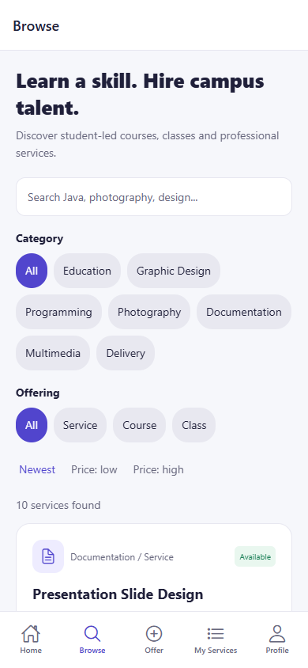
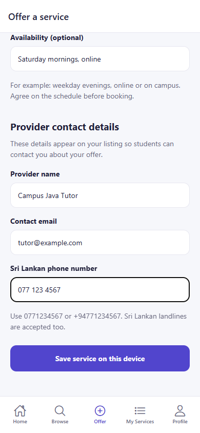

# UniTask mobile

A campus skills marketplace where students earn from their skills and hire fellow students for paid services, courses and classes. Built with **Expo SDK 58, React Native and Expo Router**, using JavaScript/JSX throughout the application.

Examples: Java individual classes, a spoken English course, event photography, graphic design and programming mentoring. A student can offer services and hire other providers with the same account.

Adapted from [UniTask web](https://github.com/YasanthaAthukorala/UniTask). The marketplace, provider contacts and light/dark/system appearance features are available on `main`.

## Offer and discover services

1. Open **Offer** and describe what you provide.
2. Choose **Service**, **Course** or **Class**, a category, an LKR price, and a price unit: per hour, class, course, project or session.
3. Add optional availability, your provider name, contact email and Sri Lankan phone number.
4. Students browse/search by category and offering type, view the price and availability, and use **Call provider** or **Email provider** to discuss the offer. Online users can also **Hire this service**.

Phone input accepts local numbers such as `0771234567`, international `+94771234567`, and `0094771234567`, with spaces, parentheses and hyphens. Landlines such as `0112345678` are supported. Numbers are stored in canonical `+94` format; malformed, foreign and overlong values are rejected without truncation. Both provider email and phone are required for new and edited listings in either mode. This validates format, not ownership.

Contact information is visible on the listing. Phone and email links open the device's dialer or email composer; the user completes the call/message. The app does not process payments or automatically send messages.

## Preview

Run `npm run web` and open **http://localhost:8081** (or the port printed by Expo).

| Campus home | Browse services | Offer a course |
| --- | --- | --- |
|  |  |  |

| Provider contact form | Provider details and contact links |
| --- | --- |
|  |  |

Screenshots come from the running Expo web application at a mobile viewport. Desktop preview: [home screenshot](docs/screenshots/home-desktop.png).

## Appearance

Open **Profile > Appearance** and choose **System**, **Light** or **Dark**. System is the default and follows device/browser appearance changes while the app is open. Explicit light/dark choices override the device preference and persist across app restarts in the existing SQLite metadata table.

The theme covers screens, listing cards, form fields, placeholders, headers, tab navigation, notifications, and the native status bar. Switching appearance does not reset forms, accounts, listings or favorites. No additional dependencies are needed.

| Light mode | Dark mode |
| --- | --- |
|  |  |

[Appearance selector](docs/screenshots/appearance-dark-mobile.png) ? [Dark service form](docs/screenshots/offer-dark-mobile.png)

## Run locally

Use Node.js 22.13 or newer and npm. This repository uses `package-lock.json`.

```sh
npm ci
npm run web
# Android / iOS development server
npm start
```

For a physical device, connect the phone and computer to the same network and use an SDK-compatible Expo Go or development build. Native folders are generated by Expo and are not maintained manually.

## Two modes

**Offline demo (default):** SQLite persists your service/course listings, provider contact details, pricing units, availability, edits, booking status and favorites on the current device. Ten sample offers seed once on new installations. Sample providers have no live phone/email, so their contact buttons remain hidden. Old installations retain their existing listings and favorites; the additive migration supplies safe defaults for the new fields and preserves old deadlines without showing them in the service form. No data reset is required. Deleting listings does not cause them to reappear.

Offline offers stay on the current device. For shared publishing and the in-app hiring action, configure the backend and sign in. Browser SQLite needs WebAssembly and cross-origin isolation; Metro supplies the required headers.

**Online accounts:** copy `.env.example` to `.env.local`, set `EXPO_PUBLIC_API_URL` to your running UniTask Express API origin, and restart Expo. Open **Profile > Sign in / Register**. The API supports registration/login, shared listings, owner editing/deletion, hiring, completed-service reviews, and notifications (refreshed every 30 seconds while that screen is open).

```dotenv
EXPO_PUBLIC_API_URL=https://your-unitask-api.example.com
```

The existing API already stores contact email and phone. To retain compatibility with its original field allowlist, the mobile adapter stores listing type, pricing unit, availability and provider display name in a readable service-details footer in the description. The mobile app decodes the footer when reading/editing; older web clients display it as readable text. Legacy API listings without a footer default to Service / Per project. The original API routes and booking statuses are retained.

For Android emulators use `http://10.0.2.2:8000`; for phones use your computer's LAN IP instead of localhost. Configure MongoDB and JWT secrets on the server, following the web repository instructions. Never put server secrets into this app; `EXPO_PUBLIC_*` values are public. Use HTTPS for deployed APIs. Sign-in tokens stay in memory and clear on sign-out/restart. Offline listings are not automatically uploaded. Favorites remain an offline feature.

## Checks

```sh
npx expo lint
npx tsc --noEmit
npm test
# Start Expo web first:
npm run test:web
# Dependency/config diagnostics when changing dependencies:
npx expo install --check
npx expo-doctor
```

Unit tests cover phone/email validation, API contact/metadata round trips, preservation of an old SQLite database, migration idempotency and one-time seeding. Database tests use Node's built-in SQLite. API tests mock transport rather than a deployed server.

Browser tests use installed Microsoft Edge by default. Alternatively install Chromium with `npx playwright install chromium` and set `PLAYWRIGHT_CHANNEL=chromium`. The marketplace workflow checks filters, favorites, invalid contacts, publishing a paid course, contact links, reload persistence, owner edits, status changes and deletion. The appearance workflow verifies saved manual choices, live system changes, themed screens/inputs and draft preservation. Both capture the screenshots above. It does not place calls or send email. Physical Android/iOS appearance rendering, system bars, keyboard/link handling and live backend behavior require separate device/server validation.

Validation on 2026-11-15: lint, JavaScript typecheck, all 7 unit/database/API tests and both browser workflows passed. Appearance captures were visually reviewed and the marketplace screenshots refreshed.

## Source layout

```text
src/app/          Expo Router routes and JSX layouts
src/components/   Shared listing cards and service form
src/constants/    Theme, categories, offering types and price units
src/database/     SQLite migration/seeding and repository/API adapter
src/services/     API transport and memory-only session
src/theme/        Shared appearance state and persistent preferences
src/data/         Offline sample services, courses and classes
src/utils/        Contact validation, API compatibility and dialogs
tests/            Unit, database, API contract and browser checks
docs/screenshots/ Actual application captures
```

Existing internal task route names and database/API identifiers are kept to preserve links and compatibility; user-facing screens use service marketplace terminology.

## Shutdown recovery

Read [DEVELOPMENT_LOG.md](DEVELOPMENT_LOG.md), then inspect `git status`, recent commits and any existing Expo listener before starting another server.

If Metro stalls before opening its port on this Windows machine, use:

```powershell
$env:CI='1'; $env:EXPO_OFFLINE='1'; npx expo start --web --port 8081 --max-workers 2
```

CI mode disables automatic reloads. Restart Expo after source edits.
