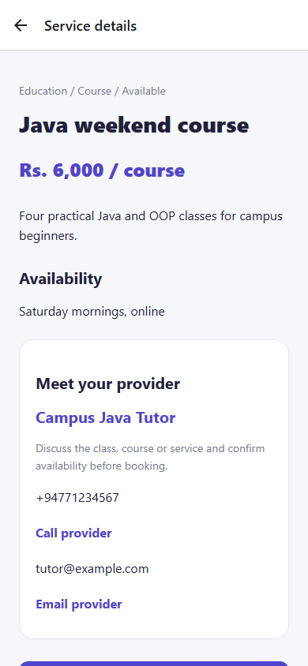
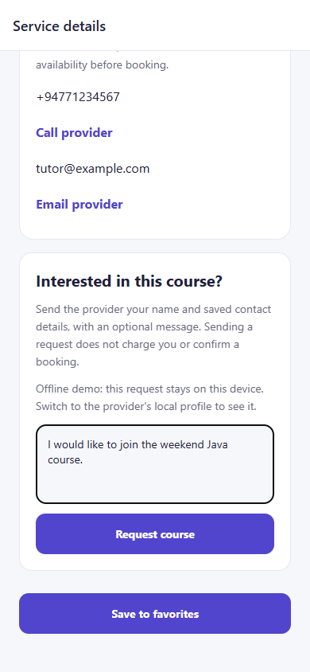
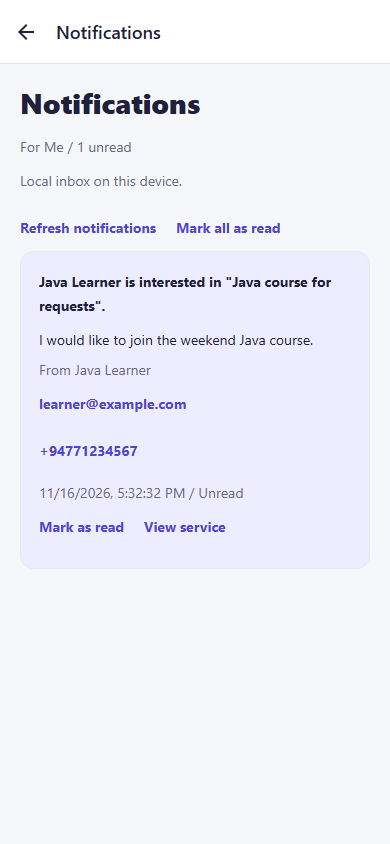

# UniTask mobile

A campus skills marketplace where students earn from their skills and hire fellow students for paid services, courses and classes. Built with **Expo SDK 58, React Native and Expo Router**, using JavaScript/JSX throughout the application.

Examples: Java individual classes, a spoken English course, event photography, graphic design and programming mentoring. A student can offer services and hire other providers with the same account.

Adapted from [UniTask web](https://github.com/YasanthaAthukorala/UniTask). The marketplace, provider contacts, light/dark/system appearance and owner interest notifications are available on `main`.

## Offer and discover services

1. Open **Offer** and describe what you provide.
2. Choose **Service**, **Course** or **Class**, a category, an LKR price, and a price unit: per hour, class, course, project or session.
3. Add optional availability, your provider name, contact email and Sri Lankan phone number.
4. Students browse/search by category and offering type, view the price and availability, and use **Call provider** or **Email provider** to discuss the offer. Online users can also **Hire this service**.

Phone input accepts local numbers such as `0771234567`, international `+94771234567`, and `0094771234567`, with spaces, parentheses and hyphens. Landlines such as `0112345678` are supported. Numbers are stored in canonical `+94` format; malformed, foreign and overlong values are rejected without truncation. Both provider email and phone are required for new and edited listings in either mode. This validates format, not ownership.

Contact information is visible on the listing. Phone and email links open the device's dialer or email composer; the user completes the call/message. The app does not process payments or automatically send messages.

## Preview

Run `npm run web` and open **http://localhost:8081** (or the port printed by Expo).

| Campus home | Browse services | Offer a course |
| --- | --- | --- |
|  |  |  |

| Provider contact form | Provider details and contact links |
| --- | --- |
|  |  |

Screenshots come from the running Expo web application at a mobile viewport. Desktop preview: [home screenshot](docs/screenshots/home-desktop.png).

## Requests and owner notifications

Opening a listing does not send a notification. A student presses **Request course**, **Request class** or **I'm interested** and can add a message of up to 500 characters. The provider receives an unread notification with the listing, sender details and message. Sending a request leaves the listing available; it does not charge money or confirm a booking.

Use the home bell or **Profile > Notifications**. The unread count appears on the bell and Profile tab. Providers can mark individual/all notifications as read, open the service, and use available sender email/phone links. Repeated requests from the same profile/account do not duplicate a notification or reset its read state. Owners cannot request their own listing. Notification text remains available after a listing is deleted.

The inbox refreshes on entry, on foreground resume, and every 10 seconds while the app is active. These are **in-app notifications**, not operating-system push notifications, SMS or automatically sent emails.

| Student request | Provider inbox |
| --- | --- |
|  |  |

## Appearance

Open **Profile > Appearance** and choose **System**, **Light** or **Dark**. System is the default and follows device/browser appearance changes while the app is open. Explicit light/dark choices override the device preference and persist across app restarts in the existing SQLite metadata table.

The theme covers screens, listing cards, form fields, placeholders, headers, tab navigation, notifications, and the native status bar. Switching appearance does not reset forms, accounts, listings or favorites. No additional dependencies are needed.

| Light mode | Dark mode |
| --- | --- |
|  |  |

[Appearance selector](docs/screenshots/appearance-dark-mobile.png) ? [Dark service form](docs/screenshots/offer-dark-mobile.png)

## Run locally

Use Node.js 22.13 or newer and npm. This repository uses `package-lock.json`.

```sh
npm ci
npm run web
# Android / iOS development server
npm start
```

For a physical device, connect the phone and computer to the same network and use an SDK-compatible Expo Go or development build. Native folders are generated by Expo and are not maintained manually.

## Two modes

**Offline local profiles (default / ICA demonstration):** All listings, requests, notifications, favorites and appearance preferences are stored on the current device in SQLite. No public API or online database is used. Ten sample offers seed once on new installations. Existing listings, deadlines, favorites and theme settings survive the versioned migration.

Open **Profile > Switch local profile**. Use **Me** as a provider, switch to **Student** (or create a learner profile with email and an optional Sri Lankan phone), and send a request. Switch back to the provider to see the inbox. Local profiles are a demonstration on one device, not password-protected online accounts. Favorites and listing ownership are separate for each local profile. Sample providers also have local profiles, so their inboxes can be inspected in the demo.

**Optional shared accounts:** This repository includes a private Node/SQLite API for accounts and notifications shared across clients. No third-party API, MongoDB or online database is required.

```sh
# Terminal 1; verified with Node.js 24.13
npm run api
# API defaults to http://127.0.0.1:8000
```

Copy `.env.example` to `.env.local`, set `EXPO_PUBLIC_API_URL=http://127.0.0.1:8000`, and restart Expo. Open **Profile > Sign in / Register**. Register a provider, publish a course/service, and use a second account to send a request. Online listings are separate from the device's offline sample data and are not uploaded automatically.

The API stores accounts, salted password hashes, hashed session tokens, shared listings and notifications in `.unitask-api/data.sqlite`. This directory is ignored by Git and excluded from Metro. Back it up if retaining shared-account data. The app keeps its sign-in token only in memory; sign in again after restarting the app.

For two phones/computers on the same LAN, start the API with `HOST=0.0.0.0`, set each app's API URL to the server computer's LAN IP (for example, `http://192.168.1.10:8000`), and use the same network. Android emulators can use `http://10.0.2.2:8000`. A LAN connection is sufficient; internet/cloud services are unnecessary. Use HTTPS when hosting beyond local development.

```powershell
$env:HOST='0.0.0.0'; npm run api
```

The original API field names/routes remain compatible. Extra listing metadata is retained in a readable description footer for older clients. A previously configured Express backend needs the interest endpoints described in [backend/README.md](backend/README.md); the included private API implements them.

## Checks

```sh
npx expo lint
npx tsc --noEmit
npm test
# Start Expo web first:
npm run test:web
# Dependency/config diagnostics when changing dependencies:
npx expo install --check
npx expo-doctor
```

Tests cover contacts, profile ownership, recipient-only inboxes, duplicate protection, old-database migration, safe read-state updates and one-time seeding. Real HTTP tests verify the included private API with separate users, persistent SQLite accounts/notifications and server restarts; the legacy adapter also retains its mocked contract test.

Browser tests use installed Microsoft Edge by default. Alternatively install Chromium with `npx playwright install chromium` and set `PLAYWRIGHT_CHANNEL=chromium`. The marketplace workflow checks filters, favorites, invalid contacts, publishing a paid course, contact links, reload persistence, owner edits, status changes and deletion. The appearance workflow verifies saved manual choices, live system changes, themed screens/inputs and draft preservation. The local notification workflow blocks backend calls and verifies profile creation/switching, owner-only delivery, contact links, read state and reload persistence. The shared-account workflow signs in two independent browser contexts and sends a request through the real private API; it requires PLAYWRIGHT_API_URL. The workflows capture the screenshots above without placing calls or sending email. Physical Android/iOS appearance rendering, system bars, keyboard/link handling and cross-phone behavior require separate device validation.

Validation on 2026-11-16: lint, JavaScript typecheck and all 13 unit/database/real HTTP tests passed. Appearance, marketplace, offline notification and two-account API browser workflows passed. Request and inbox screenshots were visually reviewed.

## Source layout

```text
src/app/          Expo Router routes and JSX layouts
src/components/   Shared listing cards and service form
src/constants/    Theme, categories, offering types and price units
src/database/     SQLite migration/seeding and repository/API adapter
src/services/     API transport and memory-only session
src/context/      Local profile and unread inbox state
backend/          Optional private Node/SQLite API
src/theme/        Shared appearance state and persistent preferences
src/data/         Offline sample services, courses and classes
src/utils/        Contact validation, API compatibility and dialogs
tests/            Unit, database, API contract and browser checks
docs/screenshots/ Actual application captures
```

Existing internal task route names and database/API identifiers are kept to preserve links and compatibility; user-facing screens use service marketplace terminology.

## Shutdown recovery

Read [DEVELOPMENT_LOG.md](DEVELOPMENT_LOG.md), then inspect `git status`, recent commits and any existing Expo listener before starting another server.

If Metro stalls before opening its port on this Windows machine, use:

```powershell
$env:CI='1'; $env:EXPO_OFFLINE='1'; npx expo start --web --port 8081 --max-workers 2
```

CI mode disables automatic reloads. Restart Expo after source edits.
